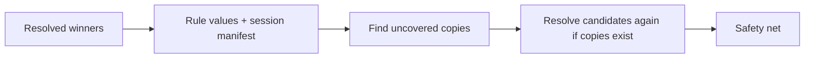

# Repeat-value sweep

After a rule finds a value, Gaze tokenizes matching copies in that document and
later texts of the same session. Changed spelling or name parts get sibling
tokens so every copy restores exactly.

## Where it runs

A full copy beats an enclosed weaker same-class fragment. Without uncovered
copies, Gaze keeps the first resolution and adds only one linear scan.

Within a text, sources protect copies before or after them. Proxy requests stage
all declared mutable JSON strings (message content, tool results, arguments).
Discovery expands owned tokens and collects deterministic Rule sources from the
original fields. It runs no learned detectors or safety nets and discards its
output. Full protection and net admission start after discovery is complete.
Each original field is then protected against the complete request evidence, so
a short name protected during discovery cannot hide part of a longer repeat.
For caller-supplied owned tokens, the proxy expands their manifest values in a
bounded view. Ordinary primary protection sees each original raw gap before
projection, preserving learned-recognizer context even when no token was supplied.
The proxy then maps every eligible Rule-repeat span back onto remaining raw bytes.
Hits remain overlapping until their raw intersections are unioned within each
gap, including contained hits and chains across several known values. A repeat
may cross either edge of a token or cover raw text between tokens. Caller-supplied
token identities stay unchanged. Compatible tokens created during the current
protection pass can merge with a Rule union before output, preventing needless
fragmentation in owner responses. Foreign classes and token families remain
separate. New fragments get reversible mappings without
becoming independent Rule sources. The expanded Rule pass runs no recognizers or nets. Full-leaf net resolution
then uses the existing core resolver to protect remaining raw gaps with complete
context, retaining owned tokens and keeping net values out of Rule propagation.
A final proof enumerates every eligible overlapping Rule occurrence on each
expanded original leaf and requires every matched byte to belong to an owned or
new token. It changes no mappings, evidence or matcher cache, and uses neither
candidate selection nor the protection projection. Any uncovered byte refuses
the request. Caller-supplied session tokens retain their exact restore spelling. Mappings commit
only after the whole request passes; a failure discards the staged session state.
Custom `RequestPseudonymizer` implementations must supply `verify_rule_coverage`.
Its default refuses rather than accepting an unproved request. The built-in
protector supplies the independent byte-coverage invariant above.
This also applies when the response uses SSE: request protection finishes before
any upstream send.

Across genuinely separate turns, sources protect only later turns. A declaration
in a later request cannot revoke bytes already sent. Daemon turns still run in
order. Buffering a complete request does not repair values split across separate
transport frames or future requests; those need an explicit ingress framing
contract.

## What propagates

Only deterministic rule evidence propagates. NER, safety-net values, and
`preserve` classes do not. On TAB court cases, NER-tagged ordinary words caused
91% of new false positives when propagated.

`Recognizer::evidence` / `Detector::evidence` declares `gaze::EvidenceKind::Rule`
or `Learned`; the registry stamps candidates. IDs imply nothing. Undeclared
emitters default to `Learned`.

| Emitter | Evidence |
| --- | --- |
| Bundled/custom regex, dictionary, anchored matches | `Rule` |
| Caller-known record matches (including daemon request context) | `Rule` |
| `gaze index` field labels, TokenBridge synthetic detector | `Rule` |
| NER, GLiNER DOB judge | `Learned` |
| NER-corroborated house numbers, `address.block.*` growth | `Learned` |
| Undeclared adopter recognizer/detector | `Learned` |
| Swept rule copy | `Rule` |
| Collision-family tie | `Rule` only when both sides are `Rule` |

A `Learned` container cannot swallow another class's enclosed `Rule` span.
The resolver splits around the rule and recovers the remainder. Nym/OPF values
are not candidates and record no session evidence.

## Matching rules

| Shape | Matching floor |
| --- | --- |
| Multi-word or letters with digits/punctuation | Any case and whitespace run; at least 4 non-space characters |
| Digit run with spaces, `-`, `.`, `/` | Flexible whitespace; at least 6 digits |
| One alphabetic word | As written, title case, upper case; at least 4 characters |
| Single part of a multi-word `Name` | Starts uppercase; as written/title/upper case; at least 3 letters |
| Adjacent run of 2+ name parts | Any case/whitespace; at least one independently eligible part (3+ letters, not common); values up to 6 parts |
| `family:<name>` value | Byte-exact; at least 4 non-space characters |

Whitespace includes tabs, line breaks, and NBSP. Short postal digits do not
sweep without their source cue/city, which supplies their precision.
Copies must use `gaze_types::is_inside_word` edges. URL-shaped runs with a scheme
or web prefix are skipped.

Names extend over hyphen/apostrophe joins through `extend_over_name_joiners`,
covering a suffix such as `-ellery` when the source ended before it. Forward
continuations need two letters; possessive `'s` and digit continuations stay
outside. This can also cover ordinary glued words such as `Kowalski-follow-up`.

Single common words never sweep alone or supply a run's distinctive part:
months, weekdays, everyday English names/nouns/verbs, and common German surnames
such as `Richter` and `Schneider`. Full values still sweep. Honorific-bearing
values use adjacent runs to protect bare names, but a run made only of common
words cannot match without the honorific.

Two more closed lists exclude standalone/distinctive parts:

- Naming particles/articles across German, Dutch, French, Spanish/Catalan,
  Portuguese, Italian, Scandinavian, Arabic/Hebrew, Gaelic/Welsh conventions.
  See `PARTICLES` and sources in `crates/gaze/src/sweep.rs`; tests enumerate
  each particle/pair. `ben` and `nic` are excluded from that list because they
  are common given names. Particles never sweep alone.
- Organization/role words such as `support`, `team`, `service`, `info`, `paket`,
  `kundenservice`, `noreply`, `newsletter`, including hyphen pieces.

Organization-shaped values (a CamelCase part, or mixed all-caps/other parts)
sweep whole values and runs, never single parts. A CamelCase single word keeps
written/title spellings without uppercase expansion. Wholly all-caps values
keep parts: this protects shouted names but can sweep parts of an all-caps
organization. CamelCase surnames lose standalone-part recall.

Case folding maps folded bytes back to whole original characters. Turkish `İ`
expands to two scalars but keeps its source span; dotless `ı` does not match `I`,
which lowers to `i`.

Known gaps include lowercase/mixed-case lone parts, common-word surnames,
sub-six-digit runs, copies in already-sent turns, model-only sources, honorific names
made solely of common words, and all-caps surnames in mixed-case names.
`VAN DER BERG` has no distinctive part and relies on NER for changed-case copies.

## Field-owned scalar repeats

The opt-in CRM/HR scanner preserves every byte of a complete quoted scalar,
including an initial LF/CRLF and terminal punctuation. Its exact repeat pattern
includes raw whitespace fringes; ordinary spelling variants retain their previous behavior.
The existing length floor is evaluated on the value body, never on whitespace.

Nested JSON escaping preserves scalar boundaries at every representable depth.
Single and triple delimiters recognize doubled quote content and complete
multiline values. The same enclosing-string bound limits every close search,
so an apostrophe in a later public field cannot close a private scalar.
An unclosed or inconsistent value owns through the nearest enclosing serialized
string close (excluded, with escape depth preserved), unescaped LF/CRLF/CR record
boundary, or input end. Key-looking private content stays in the repeat pattern;
a following assignment alone does not establish a public field. Escaped line
breaks remain value content. The enclosing JSON stays parseable.
Unclassified quote runs retain nonempty private ownership through the safe boundary.
An ambiguous tab group can retain a typed conservative prefix seed consisting
of numeric-bearing groups before its final alphabetic-only group. The whole
grouped value stays owned. This seed never declares a public boundary or
includes following label bytes. It can protect extra public prefix copies;
benchmark evidence reports that cost alongside tab-column costs.

A legacy grouped owner can also retain one earliest prefix before a complete
next-field cue consumed inside its conservative tail. The original capture and
whole tail stay protected. Unconsumed cues, prose and record separators never
license this seed; it does not declare any following namespace public. Its start
matches the owner, including a leading angle wrapper, and its end precedes the
separator and label at a UTF-8 boundary.

These seeds belong only to values found by deterministic rules.
They pass through the existing resolver and policy checks; NER-only values never
license them. A seed is an offset and kind bound to the minted owner value, so it
survives later turns and snapshot import without a separate persisted raw-value
store. Each protected prefix copy gets its own reversible mapping.

## Token identity and restore

Byte-identical copies reuse the source token. Changed spelling or a name part
gets a sibling in the same class/family. Each token maps to one exact byte string.

## Session state

Entries retain the strongest evidence tier seen. One cached multi-pattern
matcher rebuilds when sweepability or repeat-seed metadata changes; it uses the existing manifest,
without another raw-value store.

Ordinary `session_blob` snapshots remain v6 and carry evidence. A snapshot with
deterministic repeat metadata uses v8; JSON source spelling alone uses v7. A reader
supporting only v7 or earlier rejects v8 with `InvalidSnapshotVersion(8)`; the new
reader imports v2–v8.
Signatures bind the envelope version, and import rejects invalid seed offsets,
missing deterministic evidence, or seed metadata under an older envelope.
Blobs v5 and older still import/restore but cannot seed sweeps because their
evidence is unknown.

## Audit

Copies record `recognizer_id = manifest_sweep`, `provenance_stage = manifest_sweep`,
`decided_by = manifest_sweep` (`ConflictTier::ManifestSweep`), and
`provenance_merged_from = manifest_sweep:exact`, `:variant`, `:part` (parts/runs), or `:uncertain_prefix` (conservative typed prefix seeds).
Conservative prefix copies also carry `uncertain_repeat_prefix` as their typed
labelled-value reason.
Proxy projections across owned tokens use the matched Rule candidate's class and
family. Fragment mappings emit metadata-only sweep audit rows with
`provenance_merged_from = manifest_sweep:token_boundary`. They do not promote the
fragment to Rule evidence.
Rows never contain source tokens/values. Daemon overwrites the stage with
`daemon`; `decided_by` still identifies the sweep.

## Failure

Above 200,000 patterns or 16 MiB of pattern bytes, or on matcher-build failure,
return `Error::ManifestSweep`. Never emit unswept text.

## See also

- [Session contract](../core/session-contract.md)
- [How Gaze works](../how-gaze-works.md)
- Tests: `crates/gaze/tests/manifest_sweep.rs`, `crates/gaze-cli/tests/manifest_sweep.rs`, `crates/gaze-proxy/tests/manifest_sweep.rs`

A wrapper prepended by the legacy labelled-value scanner does not count toward a conservative prefix seed's precision floor. The recognizer evaluates its normalized prefix body with the same pure floor query as the sweep, then retains the original wrapper bytes and same-start geometry only when eligible. Below-floor prefixes omit the extra seed; the full declaration remains owned and restorable. Original captures that themselves include a wrapper keep their existing behavior.
