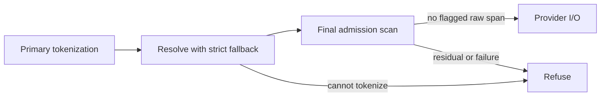

# Proxy runtime

`gaze-proxy` is a pass-through-per-provider HTTP runtime. Its north-star role is
to keep PII out of provider calls while preserving each SDK's native request and
response shape.

## Immutable request coverage and expansion limits

The legacy OpenAI and Gemini paths probe immutable request leaves against the
captured request transaction for Rule coverage. Owned tokens expand to their manifest values before
the real Rule repeat matcher runs. Full context preserves word boundaries, URL
exclusions, Unicode spelling, and compound-name growth. Learned and safety-net-only
values do not supply repeat evidence. An independent full-pipeline probe uses a
fresh discarded session, preserving baseline detector/net context. Owned classes
are not lent to neural detection: that can misclassify a public suffix even when
the Rule proof admits it. Probes discard mappings; the existing full-pipeline
control probe can still emit an audit attempt.

Every non-whitespace byte in a Rule occurrence must be owned by a token. An
uncovered whitespace gap is allowed only inside the same occurrence, between two
owned spans. Uncovered private bytes produce `UnsurfacedPii` (HTTP 422), and the
request never reaches the provider.

Full expansion has a separate resource budget shared by all immutable leaves in
one request. The default is
16 times `ProxyConfig::body_limit_bytes`: the default 2 MiB request cap permits
32 MiB of expanded UTF-8 in total, including literal bytes in probed leaves. The
proxy preflights the total with checked arithmetic before expanding any leaf,
allocating its ownership mask, or running the Rule matcher. A larger total returns
`ResidualExpansionLimitExceeded` (HTTP 413), even when every private byte is
already owned. This resource refusal is distinct from a coverage finding and is
counted separately in native gate reports. The cap limits input to the matcher;
normalization, match metadata, and concurrent requests require additional memory.

Embedding applications can override the cap with
`ProxyConfig::request_residual_expansion_limit_bytes = Some(bytes)`. `None` retains the
16-times-body-cap default. The standalone CLI uses the default. This setting does
not change the direct Anthropic codec's limits or response validation.

## Adapter contract

Adapters implement `ProviderAdapter`:

- `contract()` declares the adapter's protocol, session, routing and coverage
  behavior. It is required: an adapter that declares no contract does not
  compile. `AdapterContract::legacy()` opts into the string-surface path below,
  where the proxy re-scans the whole outbound request body after redaction and
  refuses the request if anything is left unprotected.
- `matches_path(method, path)` claims provider-native endpoints.
- `request_pii_surfaces(body)` returns mutable text leaves to redact before
  forwarding upstream.
- `response_pii_surfaces(body)` returns mutable text leaves to restore on the
  owner-visible response.
- `sse_event_pii_surfaces(event)` handles provider-native event payloads.
- `sse_event_stream_surfaces(event)` pairs each event surface with the logical
  stream it continues, such as one choice's text or one tool call's arguments.
  Providers stream about one model token per event, so a pseudonym token is
  usually split across events. The legacy proxy buffers the whole response,
  concatenates each stream's fragments, restores the result once, and replays
  it in the stream's first fragment. Keys come from the provider's own indices,
  never from an array position, so parallel tool calls never merge.
  `SseStreamKey` records the field kind and ordered provider indices. A missing
  or invalid required index disables joining for every stream of the same kind
  whose known indices agree. Those fragments restore within their own events,
  preserving wire order and leaving split tokens pseudonymized. A different
  kind or a known differing index keeps an independent stream eligible to join.
  Gemini's omitted candidate index is the protobuf JSON default 0; an explicit
  malformed index is ambiguous. The default adapter method marks every surface
  complete, which leaves a split token pseudonymized.
- `requests_json_output(request)` reports whether the request asked the model
  for JSON output. It defaults to `false`.

Adapters do not decide what is PII. They only describe where strings live; the
configured `gaze::Pipeline` and recognizer registry make detection decisions.

Each surface declares restore syntax. Protection scans its text as supplied.

| `SurfaceSyntax` | Restore |
|---|---|
| `Text` | Original bytes |
| `Json` | Escape values inside serialized JSON string literals, including tool/function/MCP arguments; works across SSE fragment boundaries |
| `ModelOutput` | `Json` when JSON output was requested, otherwise `Text` |

A value received inside a JSON string is stored in escaped spelling and written
as-is into JSON. Legacy sessions record these tokens; restoring the same value
into `Text` retains its escapes (`\"`, `\u00fc`) rather than decoding them.

OpenAI detects `json_object` / `json_schema` in `response_format.type`
(Chat Completions) or `text.format.type` (Responses). Gemini detects
`generationConfig.responseMimeType = application/json`; thought summaries stay
`Text`.

## Provider surface matrix

| Provider | Request surfaces | Response surfaces | Streaming surfaces |
| --- | --- | --- | --- |
| OpenAI | `messages[].content`, `system`, `tool_calls[].function.arguments`, `input` | `choices[].message.content`, `choices[].message.tool_calls[].function.arguments`, `output` | `choices[].delta.content`, `choices[].delta.tool_calls[].function.arguments` (keyed by choice `index` and tool call `index`); Responses API `response.output_text.delta`, `response.function_call_arguments.delta` and their `.done`, output item, content part and `response.completed` events |
| Anthropic | Strict, schema-aware Messages codec; see the [public contract](anthropic-messages-contract.md) | Strict, schema-aware Messages codec; see the [public contract](anthropic-messages-contract.md) | Strict lifecycle with proved replay; see the [public contract](anthropic-messages-contract.md) |
| Gemini | `contents[].parts[].text`, `functionCall.args`, `functionResponse.response`, `systemInstruction.parts[].text` | `candidates[].content.parts[].text`, `functionCall.args` | same parts shape per chunk; text keyed by candidate `index` |

The legacy OpenAI and Gemini adapters walk tool and function objects as native
JSON without provider-shape transcoding. The strict Anthropic direct profile is
different: it admits only its documented Messages schema, rejects unknown or
opaque media surfaces, and proves the complete transformed request or response.

## Safety nets and refusals

Configured nets, including setup-policy Nym, enforce this request path before
provider I/O:



This shares the library path used by `gaze clean --safety-net-fallback strict`.
The proxy never deletes flagged bytes one way or performs clean's extra
redact-fallback batch. A Nym `DATE_OF_BIRTH` may become
`<…:Custom:date_1>`. A `user <handle> born <ISO date>` case that clean's default
handles with username/birth-date tokens can still be refused as
`residual_suspect` for `custom:date` / `custom:username`.

Undetected PII still passes, for example an uncued `DD.MM.YYYY` date below
Nym's threshold. With no configured net, resolution/admission do nothing and
only primary protection runs.

A refusal carries its reason, never the text:

- `error`: the `ProtectionError` variant: `Residual` (a net flagged raw bytes
  that could not be protected), `SafetyNet` (a net failed to run), `Primary`,
  `Provenance`, `UnsupportedCoverage`, `EmptyPrimary` or `Untransformable` (a
  confirmed sensitive value with no safe reversible rendering).
- `reason`: present only for `Untransformable`, a closed spelling such as
  `json_number_no_text_only_path`. Field paths stay out because keys can be PII.
- `fallback_reason`: set when step 2 refused: `residual_suspect` (a later scan
  flagged something new), `overlap_conflict`, `validator_veto` or
  `anchor_missing`. It is `null` when admission refused.
- `suspect_classes`: class names, deduplicated, in a stable order. Admission
  names the suspect it rejected. A step 2 refusal names every class the nets
  flagged in that string.

Routing model identifiers need a different probe because a learned detector can
mistake a product identifier for a person or username. Anthropic and OpenAI
`model` fields and the model identifier in Gemini URLs use deterministic
recognizers when the decoded value is 1 through 128 ASCII bytes from
`[A-Za-z0-9._:/@-]`. Rules, dictionaries, validators, and the configured locale
chain still apply. A value that would change returns `422 ControlWouldMutate`;
the proxy never substitutes a token into a routing identifier. An email address
fits this grammar and still fails the deterministic probe.

Rule-backed values already established in the session manifest stay
protected. The probe uses a discarded copy of staged manifest state and cannot
publish mappings or reuse prefix-cache state.

Values outside that grammar run the full pipeline, including NER and safety
nets, against the captured request evidence and fail closed on a finding. Stop sequences, tool names and IDs,
`previous_response_id`, message content, and every other field retain the full
pipeline. A Gemini request JSON field named `model` also keeps the full pipeline;
Gemini routes by the model in its URL. The identifier grammar does not prove that a
value is free of PII. A name that fits the grammar and has no deterministic
match is outside this routing probe's coverage.

Response `model` fields use the same grammar and deterministic probe, including
Anthropic's streamed `message_start.message.model` and OpenAI Responses
lifecycle `response.model`. Rule-backed request manifest values remain
protected. A finding fails with `502 ProviderOriginPii`; an already opened
Anthropic stream emits the sanitized error frame and closes. Response model
values outside the grammar receive full validation. Every other response field
retains its existing validation; this exception does not cover `modelVersion`,
IDs, tool names, or other identifier-like fields.

At startup, `gaze proxy serve` prints
`warning: no NER model configured: person names are not detected`
when the policy has no NER model, including runs without a policy.

To verify routing with the installed NER and Nym bundles, run
`python3 scripts/ci/proxy_model_controls.py --gaze target/debug/gaze --policy target/model-policy.toml`
with a policy written by `gaze setup`.

The legacy OpenAI and Gemini adapters answer `422 Unprocessable Entity` for a
protection refusal:

```json
{
  "error": "Refused",
  "refusal": {
    "error": "Residual",
    "fallback_reason": "residual_suspect",
    "suspect_classes": ["name", "location"]
  }
}
```

The Anthropic direct profile answers `422` with its usual error envelope and
the same `refusal` object:

```json
{
  "type": "error",
  "error": {
    "type": "api_error",
    "message": "proxy_validation_failed",
    "code": "ProtectionRefused",
    "phase": "RequestTransform",
    "refusal": {
      "error": "Residual",
      "fallback_reason": "residual_suspect",
      "suspect_classes": ["name", "location"]
    }
  }
}
```

Each refusal also writes one line to the proxy's stderr, which `gaze proxy
start` sends to its log file:

```text
gaze-proxy: request refused: {"error":"Residual","fallback_reason":"residual_suspect","suspect_classes":["name","location"]}
```

Without a configured net, steps 2 and 3 do nothing and the proxy forwards the
primary output as before.

## Anthropic direct sessions

`AnthropicAdapter::new` is intentionally ephemeral and single-request. It creates
an internal session for that request and rejects any `x-gaze-session-id` header;
it does not infer continuity from a supplied header.

Continuity is opt-in through the adapter builder or equivalent host
configuration. Once enabled, every request must carry `x-gaze-session-id` with
a canonical lowercase UUIDv4 value. Active mappings are bounded and held in
memory; expiry is reported as `SessionExpired` (`410`) and is not silently
recreated. See the [strict Anthropic Messages contract](anthropic-messages-contract.md)
for registry bounds, principal resolution, and the migration from legacy
header behavior.

## Daemon lifecycle

`gaze proxy start` persists config, reexecs `gaze proxy serve --_foreground-daemon`,
and writes a pidfile:

```text
<pid>
bind=<addr>
started_at=<rfc3339>
```

The pidfile is UTF-8 and capped at 200 bytes. It lives in the platform local-data
directory:

- macOS: `~/Library/Application Support/gaze/proxy.pid`
- Linux: `$XDG_DATA_HOME/gaze/proxy.pid` or `~/.local/share/gaze/proxy.pid`
- Windows: `%LOCALAPPDATA%\gaze\proxy.pid`

Once the child has bound its port it writes a readiness marker, `proxy.ready`,
next to the pidfile. The marker holds the child's PID and bound address. It is
written to a temporary file and renamed into place, and on Unix it is owner-only
(`0600`). `gaze proxy start` and `restart` report success only after the marker
names the child they spawned, so the first request after a successful start
connects. Start removes any marker left from an earlier run before it spawns.
If the child exits first, at any point during startup, start fails with
`DaemonExitedEarly`. If the child neither binds nor exits within 120 seconds,
start stops it and fails with `DaemonStartTimeout`. Both failures remove the
pidfile and marker. Stop and stale cleanup remove the marker too.

Status and start always validate the recorded PID with process liveness checks.
If the PID is dead, the command treats the pidfile as stale and removes it
before continuing. Stop is signal-only: `SIGTERM`, bounded wait, optional
`SIGKILL` with `--force`.

The proxy exposes `/_gaze_proxy/healthz` for local health inspection. The path is
reserved outside all adapter-matched provider routes.
